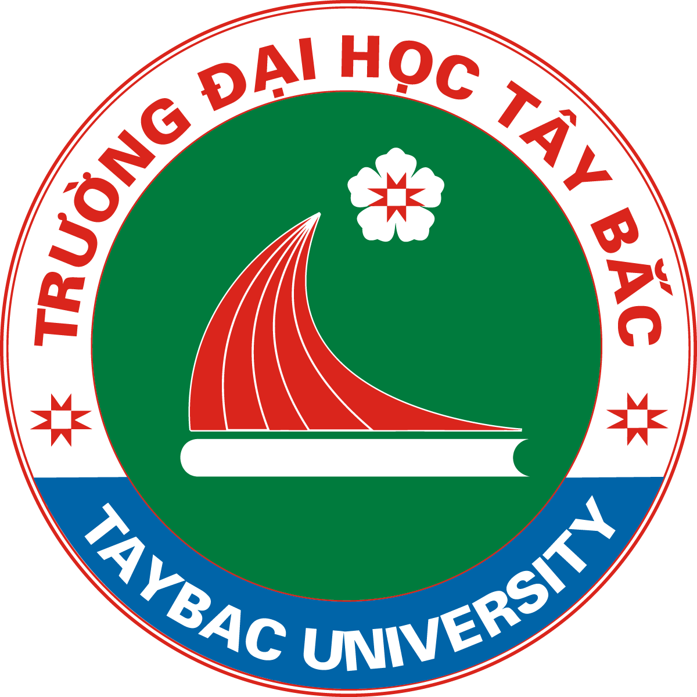
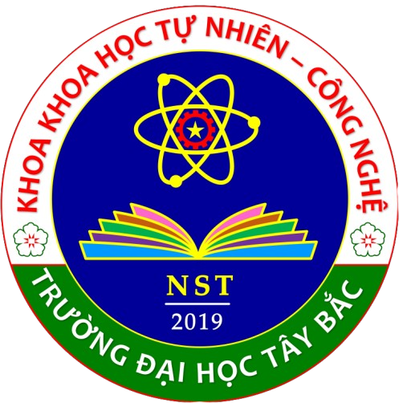

<p align="center">
  
  &emsp;&emsp;
  
</p>

<h1 align="center">UTB Beamer Theme</h1>

<p align="center">
  <b>Bộ mẫu trình chiếu LaTeX Beamer chuẩn hóa nhận diện thương hiệu Trường Đại học Tây Bắc (UTB) & Khoa Khoa học Tự nhiên – Công nghệ (NST)</b>
</p>

<p align="center">
  <a href="https://utb.edu.vn/">
    
  </a>
  &nbsp;
  <a href="https://www.facebook.com/utb.edu.vn">
    
  </a>
</p>

---

> [!NOTE]
> **Nguồn gốc & Ý tưởng**: Dự án được xây dựng và phát triển dựa trên ý tưởng từ bộ theme Beamer của Đại học Bách khoa Hà Nội: [k1m1nonawa4869/HUST-Beamer-Theme](https://github.com/k1m1nonawa4869/HUST-Beamer-Theme.git).

---

## 📌 Hai Bản Slide Mẫu (16:9 & 4:3)

Theme hỗ trợ chuyển đổi linh hoạt tỉ lệ màn hình qua tùy chọn `aspectratio` của `\documentclass`:

| Bản trình chiếu | Tỉ lệ | Mã nguồn | File PDF xuất bản | Mô tả |
| :--- | :---: | :--- | :--- | :--- |
| **Bản Wide** | **16:9** | [`test_deck_16_9.tex`](test_deck_16_9.tex) | [`test_deck_16_9.pdf`](test_deck_16_9.pdf) | Mẫu chuẩn thuyết trình hiện đại, co-branding Trường ĐH Tây Bắc & Khoa Khoa học Tự nhiên – Công nghệ (`nst-shield-utb.png`). |
| **Bản Standard** | **4:3** | [`test_variants_4_3.tex`](test_variants_4_3.tex) | [`test_variants_4_3.pdf`](test_variants_4_3.pdf) | Tương thích máy chiếu truyền thống tỉ lệ 4:3, tự động co giãn tọa độ vector và đồ họa nhận diện. |

---

## 🌐 Kênh Thông Tin Nhà Trường

- 🌐 **Website chính thức**: [https://utb.edu.vn/](https://utb.edu.vn/)
- 📘 **Fanpage Facebook**: [https://www.facebook.com/utb.edu.vn](https://www.facebook.com/utb.edu.vn)
- 📍 **Địa chỉ**: Phường Quyết Tâm, Thành phố Sơn La, Tỉnh Sơn La

---

## ✨ Điểm Nổi Bật

- **Chuẩn nhận diện thương hiệu UTB**:
  - **Màu sắc cốt lõi**: Xanh lá đậm UTB (`#12711F`), Xanh Navy (`#0B2D4F`), Vàng điểm xuyết (`#E5B80B`).
  - **Hệ thống Logo trong suốt**: Huy hiệu Trường ĐH Tây Bắc (`utb-shield.png`) và Huy hiệu Khoa KHTN – CN (`nst-shield-utb.png`) được loại bỏ nền (transparent), hiển thị liền mạch trên header và trang bìa, không có viền/hộp trắng bao quanh.
- **Tùy biến Co-branding linh hoạt**:
  - Hỗ trợ hiển thị độc lập hoặc song song 2 cấp logo: Đơn vị chủ quản (Trường ĐHTB) và Đơn vị thành viên (Khoa KHTN – CN).
- **Hỗ trợ học thuật chuyên sâu**:
  - Tích hợp sẵn môi trường định lý, bổ đề, thuật toán đa ngôn ngữ (`listings`, `minted`, `algorithm2e`), trích dẫn Biber/BibLaTeX tự động chia cột chân trang và bọc văn bản quanh huy hiệu (`wrapfig`).

---

## 🚀 Hướng Dẫn Sử Dụng Nhanh

Khởi tạo bài thuyết trình trong file `.tex`:

```latex
\documentclass[aspectratio=169,10pt]{beamer} % hoặc aspectratio=43

\usetheme[
  color=green,                                          % green | navy | blue
  font=lato,                                            % lato | times | arial | cm
  titlefont=avantgarde,                                 % avantgarde | same
  footerlogo=mark,                                      % mark | full | wordmark | utb | none
  bar=thin,                                             % thin | thick
  titlepage=cover,                                      % cover | light | solid | dark | welcome
  sectionpage=panel,                                    % panel | none
  numbering=fraction,                                   % fraction (x/y) | plain (x) | none
  progressbar=on,                                       % on | off
  dateaddress=on,
  address={Sơn La},
  logolayout=2,                                         % Bố cục logo trường: 1 | 2 | 3 | 4a | 4b
  logo2image=nst-shield-utb.png,                        % Huy hiệu Khoa KHTN - CN
  logo2vn={KHOA KHOA HỌC TỰ NHIÊN - CÔNG NGHỆ},
  logo2en={Faculty of Natural Sciences and Technology},
  logo2color=utbnavy,
  headerlogo=utb-shield.png,                            % Huy hiệu góc phải header (trong suốt, không viền)
  framebg=on,
  footermeta=on
]{UTB}

\input{utb-setup}

\title{TÊN ĐỀ TÀI / BÀI BÁO CÁO}
\author{Lò Mạnh Đạt}
\institute{Khoa Tự nhiên và Công nghệ, Trường Đại học Tây Bắc}
\date{\today}

\begin{document}
  \begin{frame}[plain,noframenumbering]
    \titlepage
  \end{frame}
  
  \begin{frame}{Tiêu đề slide}{Phụ đề slide}
    Nội dung trình chiếu...
  \end{frame}
\end{document}
```

---

## 🛠️ Biên Dịch (Compilation)

Khuyến nghị sử dụng **LuaLaTeX** (hoặc **XeLaTeX**) để xử lý phông chữ tiếng Việt Unicode hoàn hảo:

```bash
# Biên dịch LuaLaTeX kèm tài liệu tham khảo Biber
lualatex --interaction=nonstopmode test_deck_16_9.tex
biber test_deck_16_9
lualatex --interaction=nonstopmode test_deck_16_9.tex
```

*Lưu ý*: Nếu sử dụng gói tô màu mã nguồn `minted`, hãy thêm cờ `-shell-escape` khi biên dịch.
